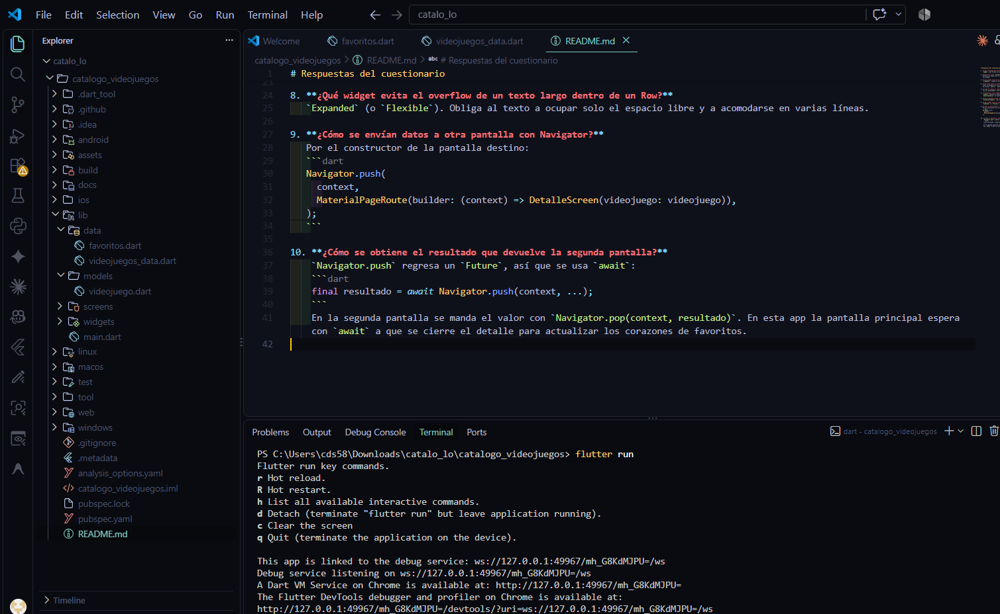

# Respuestas del cuestionario

1. **¿Qué propiedad del Scaffold coloca la barra superior con título y botones?**
   `appBar`, que recibe un widget `AppBar`. El título va en `title` y los botones en `actions`.

2. **¿Para qué sirve `elevation` en un Card?**
   Controla la sombra de la tarjeta, es decir, qué tanto parece que está elevada sobre el fondo. Un número mayor da una sombra más grande.

3. **¿Qué widget recorta una imagen con esquinas redondeadas?**
   `ClipRRect`, usando su propiedad `borderRadius`. Por ejemplo `BorderRadius.circular(16)`.

4. **¿Qué paso previo se necesita para usar `Image.asset`?**
   Crear la carpeta con las imágenes (por ejemplo `assets/images/`) y declararla en el `pubspec.yaml` dentro de `flutter:` en la sección `assets:`. Después se ejecuta `flutter pub get`.

5. **¿Cómo se cambia el tamaño y color de un Icon?**
   Con las propiedades `size` y `color`: `Icon(Icons.star, size: 30, color: Colors.amber)`.

6. **¿Diferencia entre InkWell y GestureDetector?**
   `InkWell` muestra el efecto de ondas al tocar (feedback visual) y necesita estar dentro de un widget `Material`. `GestureDetector` no muestra ningún efecto, pero detecta más tipos de gestos (arrastrar, doble toque, etc.).

7. **¿Qué propiedad alinea los hijos de un Row en su eje principal?**
   `mainAxisAlignment` (por ejemplo `MainAxisAlignment.spaceBetween`). El eje cruzado se controla con `crossAxisAlignment`.

8. **¿Qué widget evita el overflow de un texto largo dentro de un Row?**
   `Expanded` (o `Flexible`). Obliga al texto a ocupar solo el espacio libre y a acomodarse en varias líneas.

9. **¿Cómo se envían datos a otra pantalla con Navigator?**
   Por el constructor de la pantalla destino:
   ```dart
   Navigator.push(
     context,
     MaterialPageRoute(builder: (context) => DetalleScreen(videojuego: videojuego)),
   );
   ```

10. **¿Cómo se obtiene el resultado que devuelve la segunda pantalla?**
    `Navigator.push` regresa un `Future`, así que se usa `await`:
    ```dart
    final resultado = await Navigator.push(context, ...);
    ```
    En la segunda pantalla se manda el valor con `Navigator.pop(context, resultado)`. En esta app la pantalla principal espera con `await` a que se cierre el detalle para actualizar los corazones de favoritos.
